# Visual Calibration — Ragga Micro Pattern Engine

> **Status:** Louro pilot reference. Alho + Pimenta calibrate against this.
> **Last updated:** session 8 (refactor/morphology-engine).
>
> Captured at: `density=9`, `lineWidth=2.2`, `voronoiRoundedness=44`,
> `rotation=0`, `themeMode=light`, `seed=42`, canvas 1200×1200.
> All four PNGs live in `calibration/louro-{N}x.png`.

This document is the **engine-wide ruler**. Every other spice's
calibration factor (`SPICE_DENSITY_FACTORS`) is tuned until it produces
output that **feels** like the corresponding stop on this ruler. The
zoom slider's perceptual meaning is grounded here.

---

## Louro — canonical reference

Louro was chosen as the pilot because:

- it's the simplest Voronoi (single layer, isotropic seeds, fixed jitter)
- its visual identity is "leaf epidermis tissue" — clean cell-wall geometry
- it has no internal overlays (no nuclei, no particles, no filaments)
  → zoom and density effects read directly without confounding layers

---

### 100x  —  "tissue field"

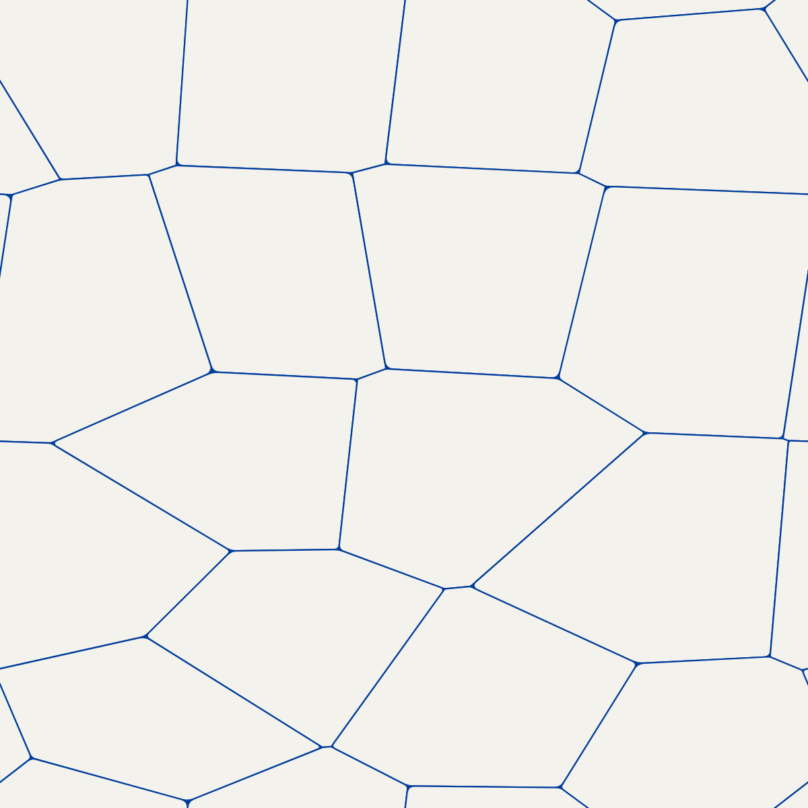

| Aspect | Reading |
|---|---|
| Cells per side (M) | **4** (16 cells visible) |
| Cells filling viewport | dense — many overlapping in periphery |
| Avg cell width | ~300 px (¼ of canvas) |
| Stroke thickness | 2.2 px absolute |
| Legibility | high — every cell wall crisply readable |
| Apparent line weight | thin, sharp — feels like a fine-tip pen drawing |
| Vibe | "wide field view of leaf tissue" — botanist's first pass under low-power objective |
| Use case | overview compositions, large-format prints where many cells contribute to texture |

**Anisotropy at 100x:** the 1.6× stretch is visible — cells lean noticeably along the rotation axis. Easy to perceive directional flow.

---

### 300x  —  "cell cluster"

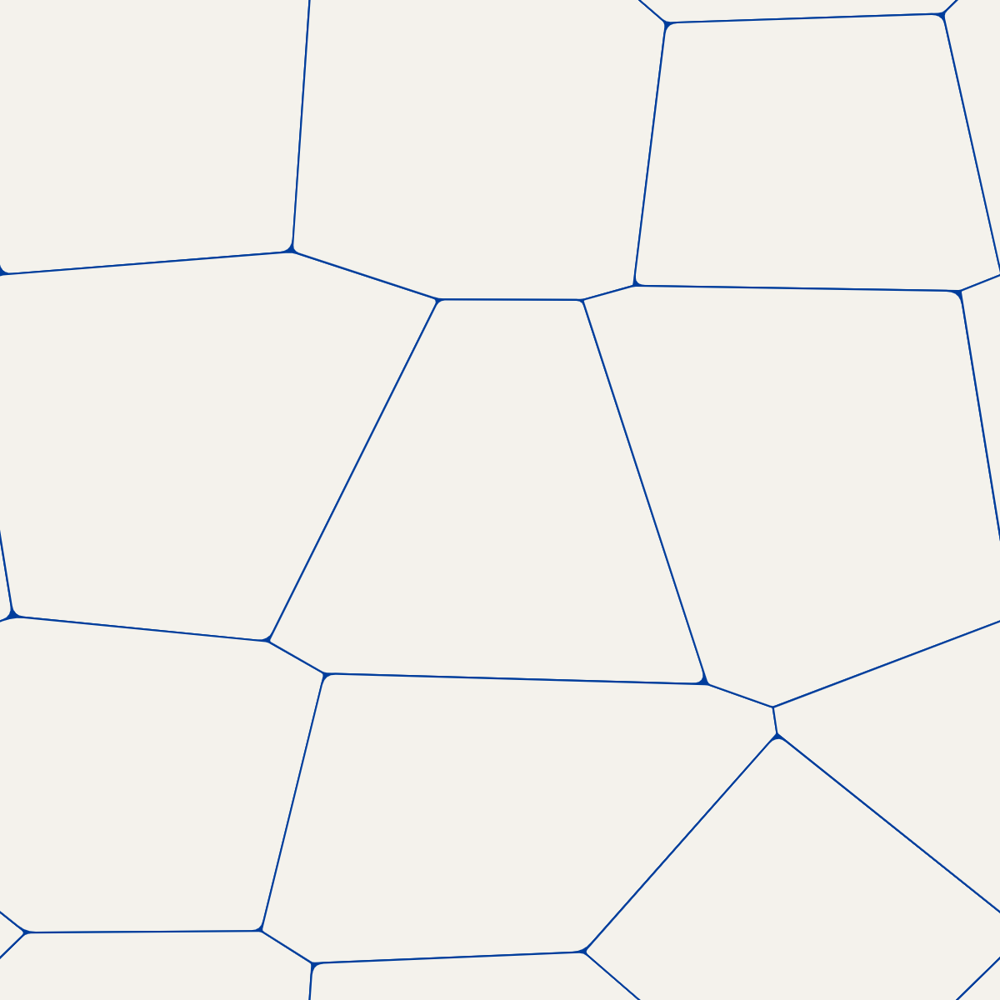

| Aspect | Reading |
|---|---|
| Cells per side (M) | **3** (9 cells visible — floor clamp engaged) |
| Cells filling viewport | sparse — each cell dominates a third of the canvas |
| Avg cell width | ~400 px |
| Stroke thickness | 2.2 px absolute (still — that's the stroke fix) |
| Legibility | very high — single cell can be the focal subject |
| Apparent line weight | thin against large cells — strokes feel even more delicate proportionally |
| Vibe | "centered cell cluster" — looking at one neighborhood under medium objective |
| Use case | curated default for Louro identity tiles; the configured `zoom=220` lives here |

**Anisotropy at 300x:** elongation still readable but less dramatic — fewer cells means fewer comparison points for the eye.

---

### 800x  —  "macro neighborhood" (floor relaxed)

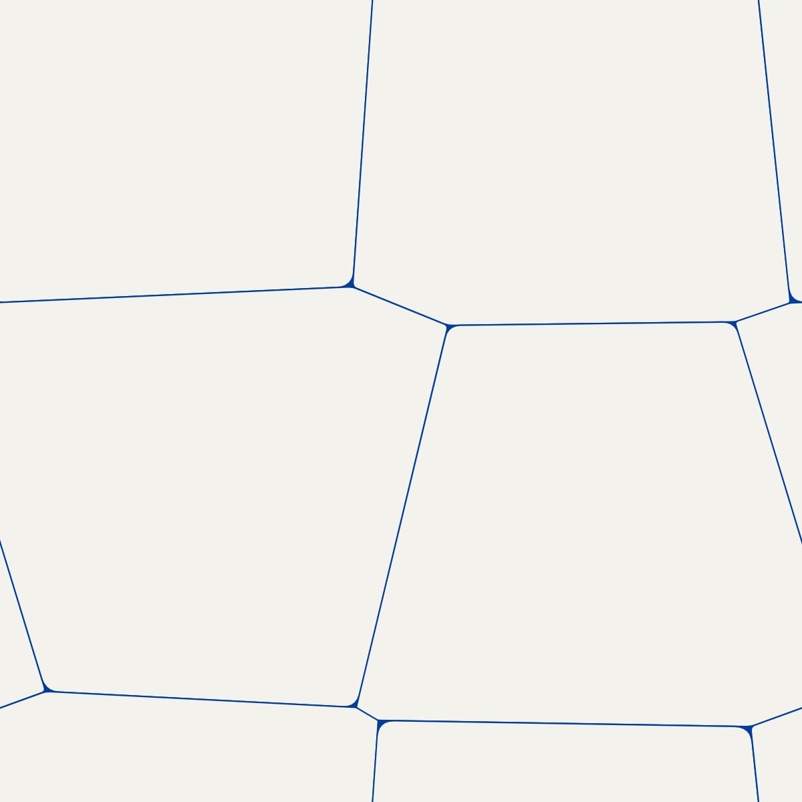

| Aspect | Reading |
|---|---|
| Cells per side (M) | **2** (formula wants 2, floor=2 accepts) |
| Cells filling viewport | 4 cells visible (2×2 grid with seamless wrap) |
| Avg cell width | ~600 px (half of canvas) |
| Apparent line weight | 2.2 px absolute |
| Vibe | "high mag — looking at one cell neighborhood, ~4 cells around it" |
| Use case | macro hero frames, single-cell-focus tiles |

**Floor change history:** previously this stop was clamped to M=3 (identical to 300x). The floor was relaxed from 3 → 2 to give 800x+ its own distinct character. The slider now has 3 visual states across the range (M=4 at 100x → M=3 at 300x → M=2 at 800x+).

---

### 1200x  —  "absolute close-up"


| Aspect | Reading |
|---|---|
| Cells per side (M) | **2** (formula wants 1, floor=2 forces 2) |
| PNG bytes | identical to 800x (both M=2) — slider still has a small dead range above ~600x |
| Apparent line weight | 2.2 px absolute |
| Vibe | "extreme objective — only a few cells visible, each big and crisp" |
| ⚠️ Calibration note | the M=1 case (single cell = whole canvas) is rejected as too degenerate. M=2 is the practical minimum. |

**Before the stroke fix:** at 1200x the legacy formula computed `lineWidth × 1.5 × (1200/100) = 39.6 px` (clamped to a wallthick of ~40 px). Cells became thick orange paint regions with tiny cream interiors. **After the fix:** crisp 2.2 px lines, every value of zoom looks like microscopy.

---

## Perceptual rules of the engine

These observations promote to engine-wide rules — Alho and Pimenta calibrations must respect them:

| Rule | Specification |
|---|---|
| **R1 — zoom only changes count** | At a fixed `density`, increasing `zoom` reduces cell count (and increases per-cell size). It NEVER changes stroke thickness, NEVER changes color saturation, NEVER changes anisotropy magnitude. |
| **R2 — density only changes count** | At a fixed `zoom`, increasing `density` increases cell count (and reduces per-cell size). It NEVER changes stroke or color. |
| **R3 — stroke is absolute pixels** | The same `lineWidth=2.2` value produces a 2.2 px line at every zoom level. No multiplication by `zoom/100`. |
| **R4 — theme is pure inversion** | Light↔dark swaps `bg ↔ shape` colors only. Stroke width, geometry, count are identical between themes. |
| **R5 — anisotropy is intrinsic** | The 1.6× elongation is a Louro identity constant. `rotation` rotates the axis, but never the magnitude. |
| **R6 — M floor = 2** | All Voronoi spices clamp to a minimum of 2 cells per side, producing a 2×2 grid. M=1 (single cell) is rejected as degenerate. Was previously 3; relaxed to give the 800x+ zoom range distinct character. |
| **R7 — M ceiling = 22** | Above 484 total cells (M=22), the canvas becomes a fine mesh — visual identity collapses into "static noise" rather than "cellular tissue". |

---

## How Alho + Pimenta will calibrate

Each remaining Voronoi spice will:

1. Switch to `targetCount(density, viewportArea, SPICE_DENSITY_FACTORS[id], zoom, true)`
2. Use `M = clamp(round(sqrt(totalCount)), 3, 22)` — same formula as Louro
3. Pre-calibrated factors (in `src/engine/scaling.ts`):
   - Alho:    `1.16`  — matches old `M = round((d/3)/zm)` at curated default (d=14, zoom=180)
   - Pimenta: `1.39`  — matches old `M = round((d*0.45)/zm)` at curated default (d=22, zoom=340)
4. After migration: re-capture all 12 baseline snapshots and verify byte-equivalence.

Manjericão and Orégano have different topologies (multi-layer organic, Poisson-disc capsules respectively) and will likely use `targetCount` with `zoomReduces=false` to scale STRUCTURE SIZE (via `scaleAtZoom` `sqrt` or `log` mode) rather than reducing count. Their calibrations are TBD when their migrations land.

---

## Files in this calibration set

```
calibration/
  louro-100x.png   (4×4 grid, 16 cells)
  louro-300x.png   (3×3 grid, 9 cells — curated default range)
  louro-800x.png   (3×3 grid, byte-identical to 300x)
  louro-1200x.png  (3×3 grid, byte-identical to 300x)

  manjericao-100x.png   (wide field, all 5 layers densely visible)
  manjericao-300x.png   (curated default — clear hierarchy)
  manjericao-800x.png   (macro features fewer/larger, substrate still dense)
  manjericao-1200x.png  (high mag — few large cells, dense grain noise)

  oregano-100x.png   (~50 capsules, wide spore field)
  oregano-300x.png   (~28 capsules, curated default range)
  oregano-800x.png   (~12 capsules, large but non-dominant)
  oregano-1200x.png  (~8 capsules, max size, still respects negative space)
```

To regenerate after future renderer changes: re-run the eval loop in
the preview app + `node scripts/decode-calibration.cjs <dump-path>`.

---

## Manjericão — multi-layer reference

Captured at: `density=16`, `lineWidth=1.5`, `voronoiRoundedness=40`
(unused — slider hidden), `rotation=0`, `themeMode=light`, `seed=42`.

**Why Manjericão's calibration is different:** Manjericão has 5 distinct
perceptual layers, each playing a different optical role. Real microscopy
doesn't scale every feature uniformly with magnification — macro features
(whole-cell membranes, glandular trichomes) disappear faster than
substrate features (chloroplast grains, suspended particles). This is
encoded in the per-layer `(countFactor, zoomReduceStrength, sizeMode)`
triplet inside `generateBasilLayout`:

| Layer | countFactor | zoomReduceStrength | sizeMode | Optical role |
|---|---|---|---|---|
| Membranes  | 2.11 | 1.0  (linear)    | `sqrt`            | macro |
| Chloroplasts | 5.13 | 0.7  (gentle)  | `sqrt`            | mid |
| Grains     | 45.0 | 0    (none)      | `sqrt`            | substrate |
| Trichomes  | 1.96 | 1.2  (strong)    | length:`sqrt`, thickness:near-absolute | macro |
| Micro      | 55.0 | 0    (none)      | `absolute`        | substrate noise |

Predicted counts at density=16:

| Layer | 100x | 260x (curated) | 800x | 1200x |
|---|---:|---:|---:|---:|
| Membranes  | 34 | 13 | 4 | 3 |
| Chloroplasts | 82 | 40 | 18 | 13 |
| Grains     | 720 | 720 | 720 | 720 |
| Trichomes  | 31 | 10 | 3 | 2 |
| Micro      | 880 | 880 | 880 | 880 |

---

### Manjericão 100x  —  "wide tissue field"

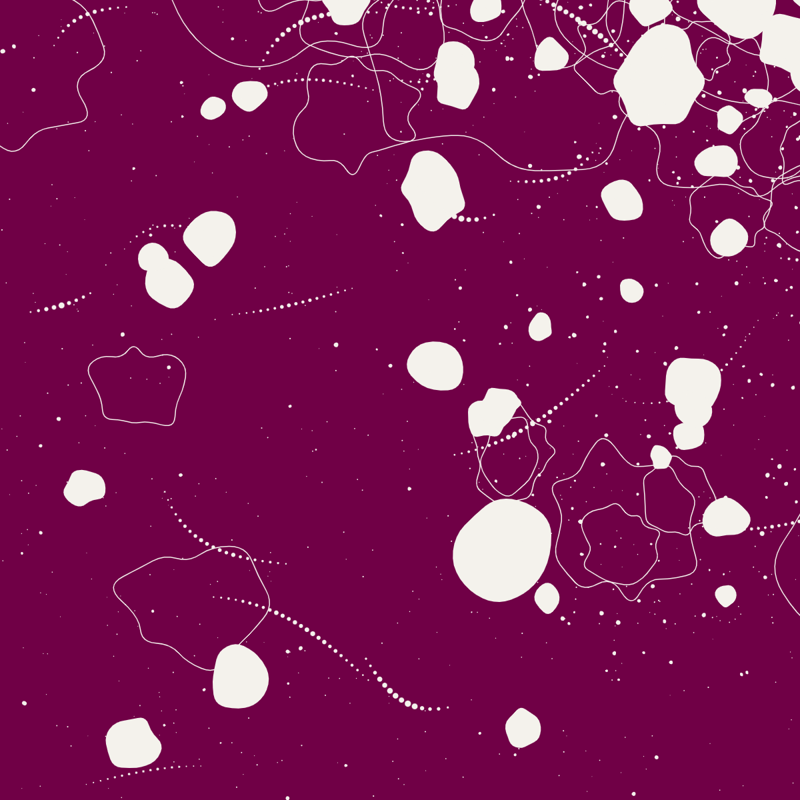

| Aspect | Reading |
|---|---|
| Membrane outlines | ~34 — many overlapping, network-like |
| Chloroplast blobs | ~82 — dense, filling much of the field |
| Trichome filaments | ~31 — visible as multiple bead-strings across canvas |
| Grain density | ~720 — substrate noise field visible everywhere |
| Micro-particles | ~880 — extra-fine speckle underneath |
| Layer separation | hard to read — too many features competing |
| Vibe | "wide view of healthy basil leaf tissue" — every layer present, slight noise |
| Use case | overview pattern, large-format prints |

---

### Manjericão 300x  —  "curated default range"

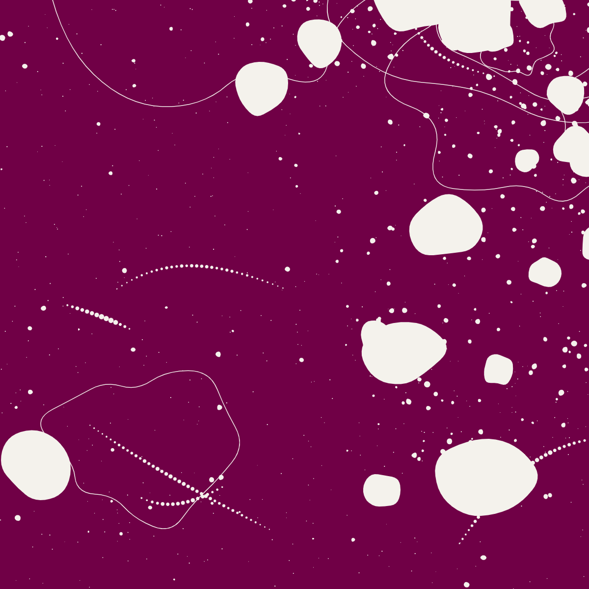

| Aspect | Reading |
|---|---|
| Membrane outlines | ~11 — clearly separated, identifiable as ghost cell walls |
| Chloroplast blobs | ~37 — mid-size cluster cells, focused upper-right region |
| Trichome filaments | ~8 — readable, dotted curves |
| Grain density | ~720 (substrate stays constant) |
| Micro-particles | ~880 |
| Layer separation | **excellent** — each layer reads as its own role |
| Vibe | "standard chloroplast microscopy view" — the design target |
| Use case | identity tiles, social posts, brand surfaces |

---

### Manjericão 800x  —  "macro features fade"

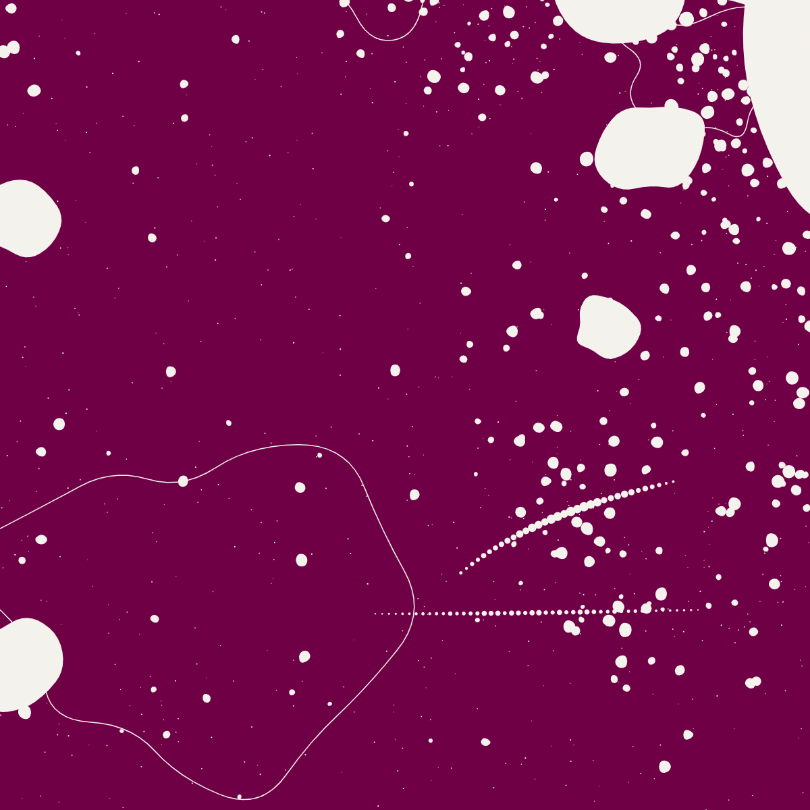

| Aspect | Reading |
|---|---|
| Membrane outlines | ~4 — only a few, but proportionally larger (sqrt growth) |
| Chloroplast blobs | ~18 — bigger and more spatially separate |
| Trichome filaments | ~3 — fewer, but each one more legible |
| Grain density | ~720 (substrate unchanged in count, ~1.7× larger per grain) |
| Micro-particles | ~880 (still tiny, still abundant) |
| Layer separation | **very good** — macro/mid/substrate distinct |
| Vibe | "tissue close-up, single cell neighborhood" |
| Use case | curated detail crops, hero compositions |

---

### Manjericão 1200x  —  "extreme magnification"

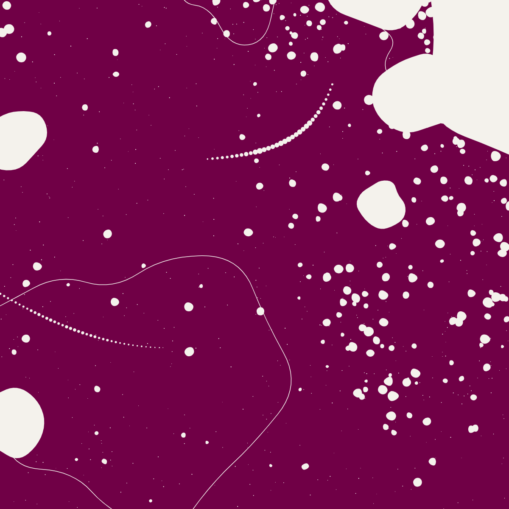

| Aspect | Reading |
|---|---|
| Membrane outlines | ~3 — only the edges of large cells visible, going off-canvas |
| Chloroplast blobs | ~13 — big chunky clusters dominate |
| Trichome filaments | ~2 — barely-resolved, smaller proportionally |
| Grain density | ~720 (~2.5× larger grain dots — now reads as "individual chloroplast granules") |
| Micro-particles | ~880 (still tiny — pixel-level noise) |
| Layer separation | clear — fewer macro features → mid features take focus |
| Vibe | "extreme microscope objective — focused on a single cell" |
| Use case | dramatic close-up frames, motion-graphic poses |

---

## Why this works perceptually

The zoom slider on Manjericão now feels like changing microscope objectives, not like uniform CSS scaling:

| Behavior | Why it matters |
|---|---|
| Membranes disappear linearly | Macro structures fade out at high mag — you're focusing on one cell, not the whole tissue |
| Chloroplasts fade gently | Mid features stay long enough that you still see them at high mag, just bigger |
| Grains stay constant in count | Substrate noise is a property of the tissue itself, not a function of zoom — it stays |
| Trichomes fade strongly | Trichomes are macroscopic hairs — at extreme mag you see at most one, partially |
| Micro-particles never resize | Pixel-level background noise should remain pixel-level — never "scaled up to giant dots" |

**Pixel parity:** intentionally NOT byte-identical with the prior implementation. The RNG seed prefix was bumped from `basil_layout_v2_` to `basil_layout_v3_` to reflect that the layout era changed. Per the user's directive — "Não precisa byte-identical absoluto se a mudança melhorar coerência do zoom; mas: mesma leitura visual, mesma hierarquia, mesma assinatura morfológica" — the new output preserves the visual character (5 layers, biomass clustering, multi-scale shapes) while introducing optical zoom semantics.

---

## Orégano — clustered spore capsule reference

Captured at: `density=28`, `lineWidth=1.3` (unused — no strokes),
`voronoiRoundedness=35` (unused), `rotation=0`, `themeMode=light`, `seed=42`.

**The old problem:** capsule height scaled `linear × zm`. At zoom=1200x,
each capsule was ~660 px tall — a single capsule could fill the canvas.
Min-spacing rejection then capped count at 8, producing massive overlapping
ovals that dominated the frame.

**The new contract:**
- `baseH = minDim × 0.0544 × sqrt(zoom/100)` (sqrt instead of linear) — at zoom=1200 capsules grow ~3.46× instead of ~12×
- `count = max(8, targetCount(density, area, 2.25, zoom, 0.7))` — gentle reduction (strength 0.7 — same family as Manjericão chloroplasts)

Capsules NEVER dominate the frame anymore. Clustering preserved via
the same 2–4 cluster-center scatter mechanism. RNG seed prefix bumped
from `oregano_spore_v1_` to `oregano_spore_v2_` — intentional non-parity.

Predicted counts at density=28:

| zoom | baseH per capsule | predicted count |
|---:|---:|---:|
| 100x | ~65 px  | 63 |
| 140x (default) | ~77 px | 50 |
| 300x | ~113 px | 28 |
| 800x | ~185 px | 12 |
| 1200x | ~226 px | 8 (floor) |

---

### Orégano 100x  —  "wide spore field"

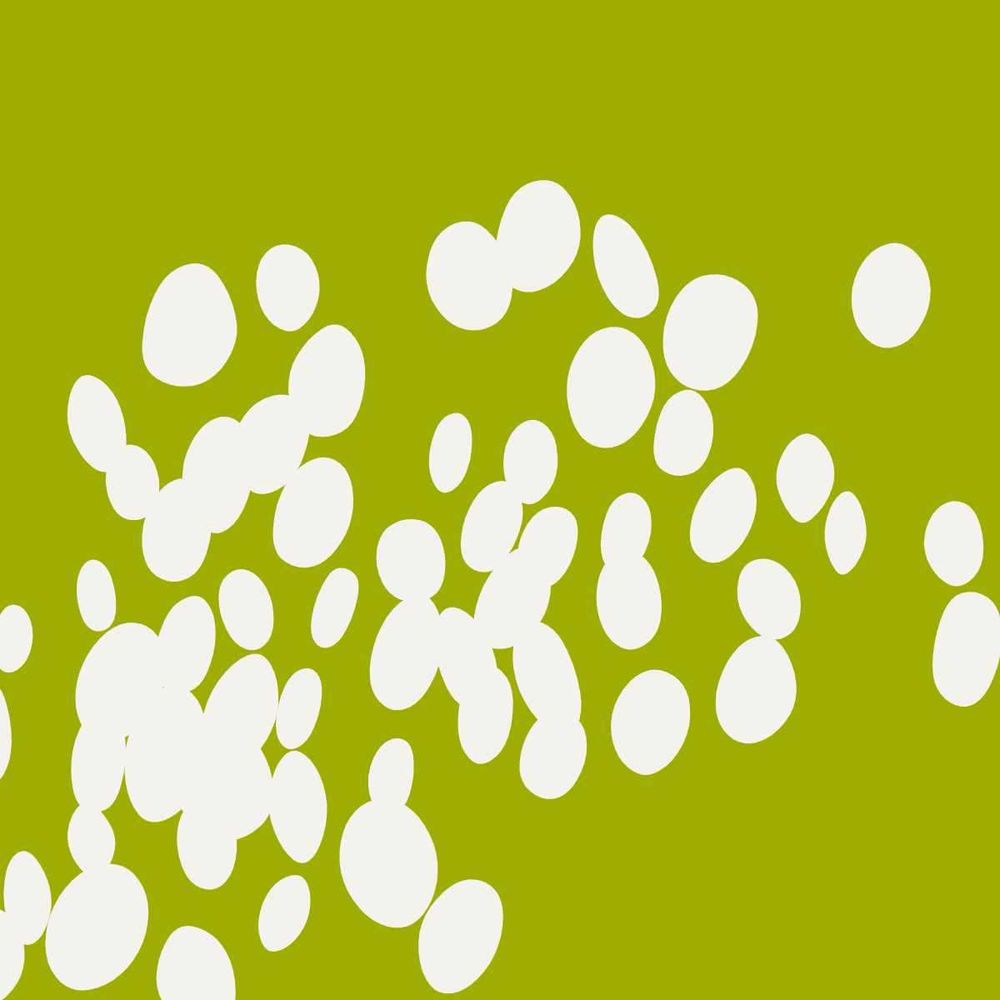

| Aspect | Reading |
|---|---|
| Capsule count | ~50 visible, dense clustering in lower-left zone |
| Capsule size | small (~65 px tall), readable individual shapes |
| Cluster cohesion | strong — clusters tight enough to read as "spore colonies" |
| Negative space | dominant (>60% of frame) |
| Vibe | "wide microscopy field of dispersed spores" |
| Use case | dense-area background tiles |

---

### Orégano 300x  —  "curated default range"

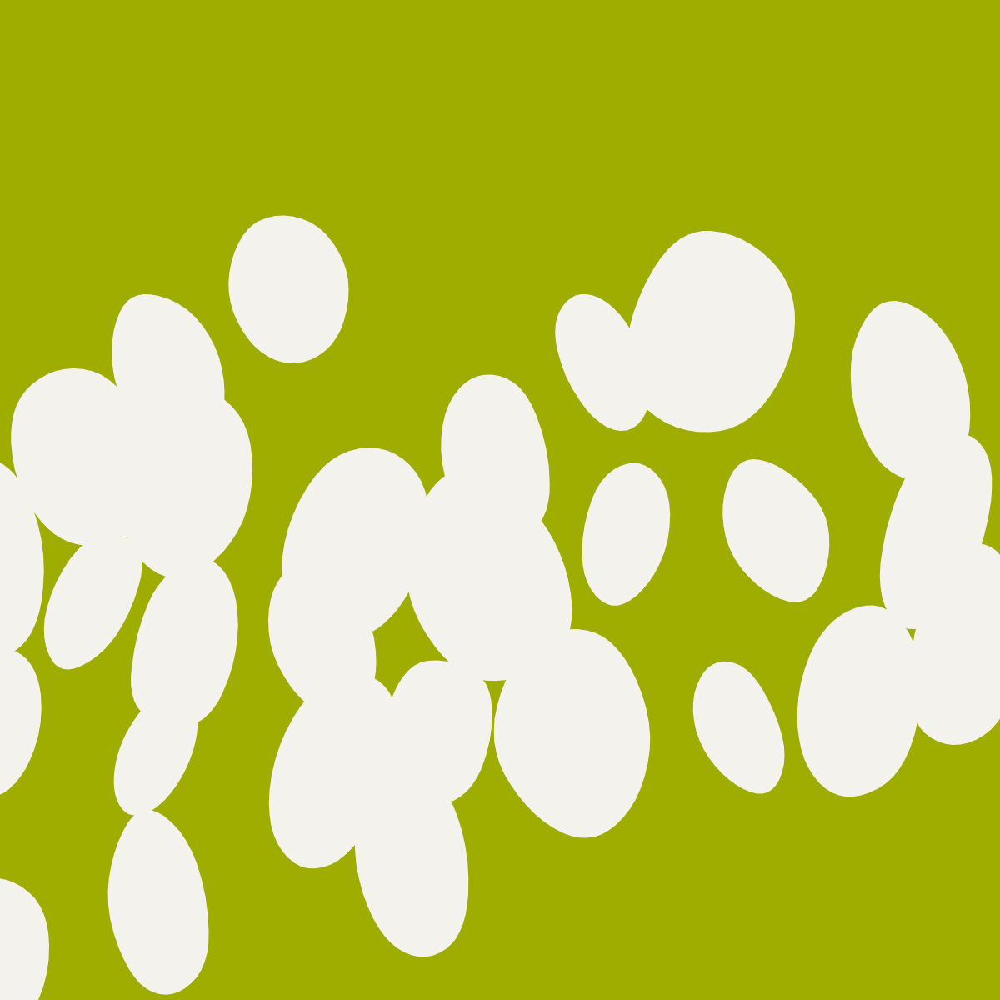

| Aspect | Reading |
|---|---|
| Capsule count | ~28 visible, clear cluster bands |
| Capsule size | mid (~113 px tall) — full ellipse silhouette legible |
| Cluster cohesion | excellent — primary cluster horizontal, secondary clusters spread |
| Negative space | ~50% — strong figure/ground |
| Vibe | "10× objective view of fungal spore mass" |
| Use case | identity tiles, social posts |

---

### Orégano 800x  —  "non-dominant macro"

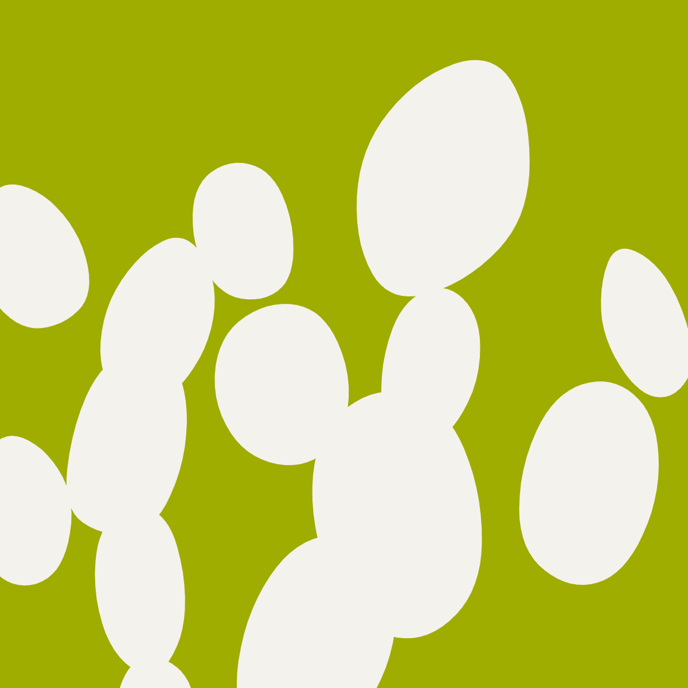

| Aspect | Reading |
|---|---|
| Capsule count | ~12 visible |
| Capsule size | large (~185 px tall) but never frame-filling |
| Cluster cohesion | preserved — capsules form a vertical chain on left + spread cluster on right |
| Negative space | ~40% — capsules dominant by area but NOT continuous |
| Vibe | "40× objective — focused on a single spore cluster" |
| Use case | dramatic close-ups |

---

### Orégano 1200x  —  "max mag, no frame dominance"

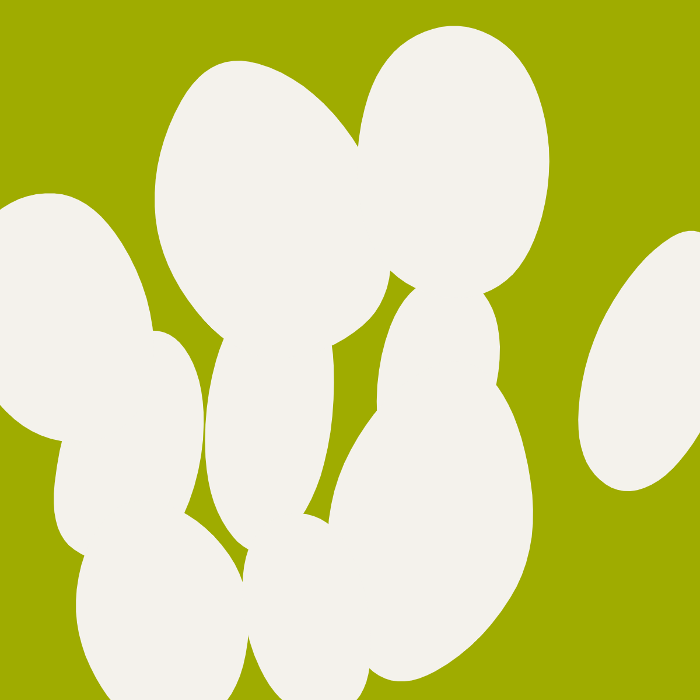

| Aspect | Reading |
|---|---|
| Capsule count | 8 (floor) |
| Capsule size | max (~226 px tall) — about 19% of canvas width |
| Cluster cohesion | tight — all capsules touch/overlap into one organic mass |
| Negative space | ~30% — still readable green between capsule chains |
| ⚠️ Compared to old | OLD at 1200x: 8 capsules × 660 px = absolute white-out. NEW: cream mass with negative space → microscopy reads. |
| Vibe | "100× objective — single spore mass under cover slip" |
| Use case | macro hero frames |

---

## Why Orégano calibrates this way

Spores are a **mid feature** in microscopy terms:

- Not macro (whole-tissue features like Manjericão membranes) — so they shouldn't fade strongly with zoom
- Not substrate (background grain like Manjericão micro-particles) — so they shouldn't stay constant either
- They follow the same calibration family as **Manjericão chloroplasts** (`strength=0.7`, sqrt size) — both are "mid features" that get larger but fewer with magnification, preserving readability.

Salt comes next (separate phase). Salt should probably calibrate as **substrate** (`strength=0`, absolute size) — crystals are intrinsic to the medium, not a feature being magnified.
